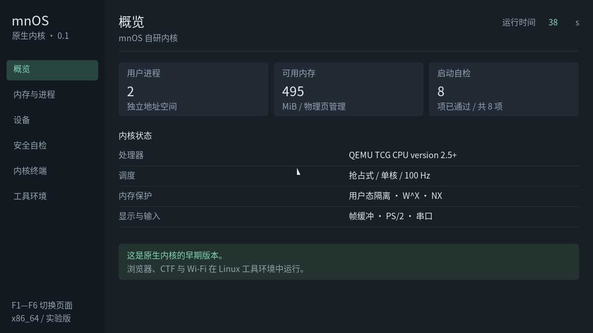
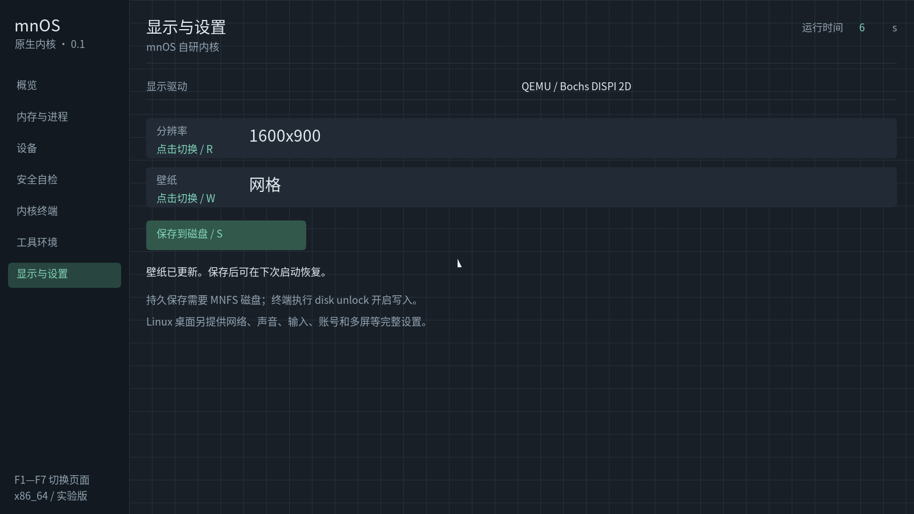
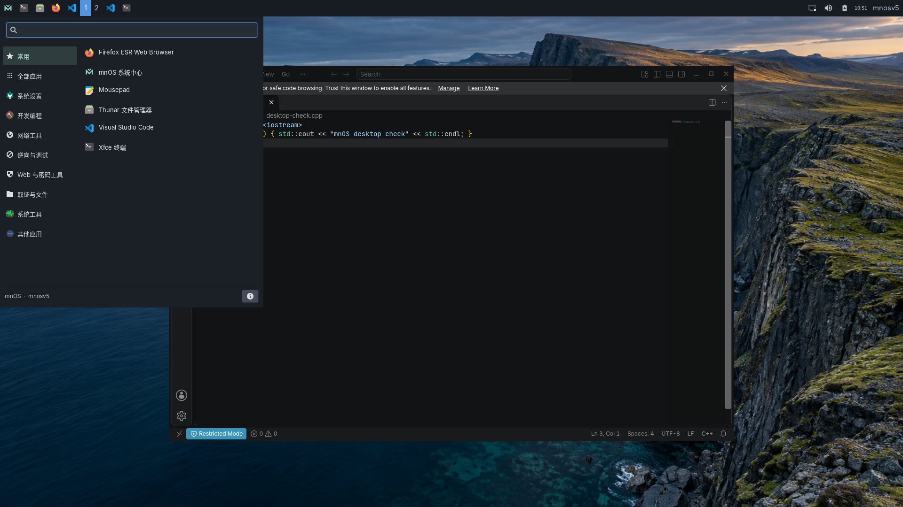

# mnOS

[下载原生图形系统安装 ISO：AMD64 / ARM64](https://github.com/zengyiqian2014-boop/mnOS/releases/tag/v0.4-desktop-preview.1)
· [安装、操作与测试说明](native/DESKTOP.md)

**mnOS Desktop 0.4 安装后直接启动自研 C／汇编内核和原生图形桌面。**
每个架构一份 ISO，集成图形安装器、引导加载、桌面窗口、应用菜单及搜索、文件浏览、
文本编辑器、终端、系统监视、设备与个人设置、本地账号。文件和设置保存在 MNFS；
移除 ISO 后可从磁盘启动。本镜像不含 Linux、Xfce 或 Python 运行时。
F1–F7 打开应用，编辑器 Ctrl-S 保存，左上角 Applications 可搜索工具。

这是基础原生 GUI 的开发预览版，桌面服务目前仍在内核内运行。Firefox、VS Code、
Linux 二进制兼容、原生网络／Wi-Fi、USB、AHCI/NVMe、音频、加速 GPU 和 APFS
尚未完成。具体测试设备和功能限制见安装说明，不宣称兼容全部硬件或已适合日常使用。

[旧 v2.0 Linux/Xfce 安装包](https://github.com/zengyiqian2014-boop/mnOS/releases/tag/v2.0-installer-preview.2)
是另一个独立的 Debian 应用环境；其中的浏览器和驱动不计入原生系统，也不标为自研。
原生 0.3 系列是内核开发启动介质；0.4 新增了实际可安装的原生桌面流程。

自研内核已有独立原生 ELF、动态进程、抢占调度、休眠／唤醒、进程所有权及文件系统调用。
原生应用当前共享启动 CPU，采用小型静态 ABI。[原生程序说明](native/README.md#run-native-programs-from-mnfs)。

x86_64 自研内核已完成 32 核和 33 TiB 稀疏 QEMU 内存验证，仍是实验版本。没有固定 CPU
数组上限，但实际规模受硬件与内存约束；测试结果不等于实体硬件全覆盖或安全认证。
具体范围见[验证记录](live/VALIDATION.md)、[MNFS 说明](native/FILESYSTEM.md)及
[安全与性能设计](live/DESIGN.md)。MNFS 使用独立格式，不兼容 APFS。

**`help` 默认英文，`help -cn` 显示中文。** 两个环境都支持以下帮助命令：

```sh
help                         # 英文帮助
help -cn                     # 中文帮助
kernel help                  # 内核命令英文说明
kernel help -cn               # 内核命令中文说明
kernel gpu                   # Linux：普通用户查看绑定的显卡驱动
sudo kernel performance balanced  # Linux：管理员切换 TuneD 配置
```

原生 F7 设置页可调整受支持的 QEMU 分辨率和壁纸，并保存到 MNFS 磁盘。
Linux 系统中心提供显示、壁纸、声音、网络、账号等设置。Python 保留，供相关
工具使用。Linux 安装过程创建具有 sudo 授权的普通账号；root 登录锁定，没有默认
密码。/usr/bin/kernel 负责查询，/usr/sbin/mnos-kernel-admin 检查 root 身份后执行
修改操作。受限制的日志和参数仍遵循 Linux 权限。

自研内核有独立的账号认证：首次创建普通用户及 root 密码，`su` 切换管理员，
个人文件读写和显示设置无需 root。有 MNFS 磁盘时保存账号；无磁盘时只在本次
启动有效。原生账号与 Linux 账号不共用。

安装时可选网络工具权限：默认特权操作需要 sudo；也可向本次创建的账号开放
`CAP_NET_ADMIN` 和 `CAP_NET_RAW`，例如通过 `mnos-net nmap ...` 免 sudo 使用
网络特权，账号仍保持普通 UID。其他账号不会自动获得授权。普通联网、TCP 连接
扫描、编辑个人文件、使用 VS Code 和编译项目都不需要 root。

自研内核在 QEMU 中独立运行的画面：



原生显示设置，截取自 QEMU/OVMF 实际运行画面：



Linux 工具环境的开发版实测画面：



[普通账号用 VS Code 编辑 C++ 文件的实测画面](assets/linux-vscode.png)。

[English](README.md) | [中文](README.zh.md)

左上角 **应用与工具** 按钮可搜索已安装应用和 122 个命令行工具入口；命令行条目打开终端帮助。内核、显示、壁纸和分区管理统一放进 **系统设置**，并更新风景壁纸、字体大小和清晰度。

## 原版 BusyBox 版本

原版仍单独保留：**Linux 6.13.3 + BusyBox + GRUB**，提供 FHS 目录树和 BIOS/UEFI
启动 ISO。下文针对这个旧版；双启动桌面版请看 [live/README.md](live/README.md)。


## 特性

- 完整 FHS 目录结构（`/bin /etc /usr /var /proc /sys ...`）
- busybox 用户空间，400+ applet（sh、vi、top、grep、awk...）
- 开机自动进入 shell（无登录），启动日志结束后**清屏并显示系统信息卡片**
- 彩色提示符 `[\W]#`，以及快捷命令 `off`（关机）`rb`（重启）`ll`（列文件）
- GRUB 菜单与内核 framebuffer 同为 **1280×720（16:9）**
- 串口 / VGA 双控制台输出，`ls`、`mneofetch` 等命令两边都能正常显示
- 静态根文件系统打包，启动快（约 3 秒到 shell）
- 本地 **`ai`** 对话机器人：纯 Python 实现的 MiniMind2（llama）CPU 推理，输入 `ai` 即可聊天

## 运行

构建后可以直接启动，脚本默认读取仓库上一级目录中的 ISO：

```bash
./run.sh                          # QEMU 显示窗口，1024 MiB 内存
./run.sh --serial                  # 终端模式；先按 Ctrl-A，再按 X 退出 QEMU
./run.sh --memory 2048 /path/to/mnOS.iso
```

能访问 `/dev/kvm` 时使用 KVM，否则使用 QEMU 软件模拟。
可以用 `QEMU=/path/to/qemu-system-x86_64` 指定 QEMU 程序。

也可以直接调用 QEMU：

```bash
# 图形模式（GRUB 菜单 + VGA 控制台）
qemu-system-x86_64 -enable-kvm -m 512 -cdrom mnOSv1.7.iso

# 串口模式（终端里直接交互）
qemu-system-x86_64 -enable-kvm -m 512 -cdrom mnOSv1.7.iso -nographic
```

> 内置的 `ai` 模型需要更多内存 —— 运行 `ai` 前请用 `-m 1024` 启动 QEMU。

### 可选桌面


```bash
WITH_DESKTOP=1 DEFAULT_DESKTOP=1 ./build.sh
./run.sh
```

桌面直接使用 Linux framebuffer，提供终端入口、实时内存与运行时间、
快捷键帮助和关机／重启确认。按 **T** 打开终端，输入 `exit` 返回桌面；
Tab／方向键与 Enter 选择卡片，**S** 查看系统状态，Esc 返回或退出到控制台。
鼠标需要内核提供 `/dev/input/mice`。原内核可用键盘操作，下面的可选 QEMU
内核也启用了鼠标支持。

需要 Linux 虚拟终端和至少 640×480 的真彩色 framebuffer。在已运行的 Shell
里输入 `start-desktop`，可在 tty2 启动桌面。串口终端和 GRUB 原控制台菜单保留；
不设置 `DEFAULT_DESKTOP=1` 就仍以控制台为默认入口。文件仍保存在内存里。

构建桌面需要 C 编译器及静态 libc 开发文件（Debian 可安装 `gcc libc6-dev`），
无需显示服务器或额外 GUI 运行库。字体使用随源码附带、保留署名的公有领域位图字体。

### 可选 QEMU 内核

默认仍使用仓库中的 `boot/bzImage`。从 kernel.org 下载并解压 **Linux 6.13.3**
后，可以另行编译用于 QEMU 的内核：

```bash
JOBS=4 ./tools/build-qemu-kernel.sh /path/to/linux-6.13.3 /path/to/kernel-build
KERNEL_IMAGE=/path/to/kernel-build/arch/x86/boot/bzImage \
  WITH_DESKTOP=1 DEFAULT_DESKTOP=1 ./build.sh
```

该配置以 `x86_64_defconfig` 为基础，支持最多 8 个虚拟 CPU，启用体积优化，
去掉音频、无线、媒体和实体显卡驱动，保留 Bochs／virtio 显示与输入驱动，
补上鼠标设备，并通过 `/proc/config.gz` 导出配置。它面向 QEMU，其他硬件请使用
默认内核。最终配置也保存在输出目录的 `.config` 中。编译依赖
`make gcc bc flex bison libelf-dev libssl-dev` 及 libc 开发文件。

开发检查：

```bash
python3 -m unittest discover -s tests -p 'test_*.py'
GEN_INIT_CPIO=/path/to/gen_init_cpio ./tests/test-build-mountpoints.sh
cc -fsanitize=address,undefined -g tests/test_desktop.c -o /tmp/test-desktop
/tmp/test-desktop
```

## 构建

### 一键构建

```bash
./build.sh          # 重新打包 initramfs 并生成 ../mnOSv1.7.iso
```

依赖：`grub-mkrescue`、`cpio`、`gzip`，以及内核源码里的 `gen_init_cpio`
（可用 `GEN_INIT_CPIO=/path/to/gen_init_cpio` 覆盖，`OUT=...` 指定输出路径，
`KERNEL_SRC=...` 指定内核源码目录）。

### 前置组件（内核 / busybox）

#### 1. 内核

```bash
git clone --depth=1 -b v6.13.3 https://github.com/torvalds/linux.git
cd linux
make olddefconfig          # 关键项: BLK_DEV_INITRD, DEVTMPFS, VT, DRM_BOCHS,
                            # FRAMEBUFFER_CONSOLE, SERIAL_8250_CONSOLE, ISO9660_FS
make -j$(nproc)
cp arch/x86/boot/bzImage ../
```

#### 2. busybox

```bash
git clone https://git.busybox.net/busybox
cd busybox
make defconfig             # 动态链接（CONFIG_STATIC is not set）
make -j$(nproc)
make CONFIG_PREFIX=../mnOS install
```

根文件系统需要带上 busybox 依赖的动态库（glibc）：

```bash
mkdir -p mnOS/lib/x86_64-linux-gnu
cp -a /lib/x86_64-linux-gnu/{libc,libm,libresolv,libnss_files,libnss_dns}-2.31.so* \
      /lib/x86_64-linux-gnu/ld-2.31.so mnOS/lib/x86_64-linux-gnu/
ln -sf /lib/x86_64-linux-gnu/ld-2.31.so mnOS/lib64/ld-linux-x86-64.so.2
printf '/lib/x86_64-linux-gnu\n/usr/lib/x86_64-linux-gnu\n' > mnOS/etc/ld.so.conf
ldconfig -r mnOS
```

#### 3. initramfs（无需 root）

设备节点不用 `mknod`，用内核自带的 `gen_init_cpio` 写进 cpio 头即可：

```bash
cat > devspec <<'EOF'
dir /proc 0755 0 0
dir /sys 0755 0 0
dir /dev 0755 0 0
nod /dev/console 0600 0 0 c 5 1
nod /dev/tty      0666 0 0 c 5 0
nod /dev/tty0     0600 0 0 c 4 0
nod /dev/tty1     0600 0 0 c 4 1
nod /dev/ttyS0    0666 0 0 c 4 64
nod /dev/null     0666 0 0 c 1 3
nod /dev/zero     0666 0 0 c 1 5
nod /dev/random   0666 0 0 c 1 8
nod /dev/urandom  0666 0 0 c 1 9
nod /dev/ptmx     0666 0 0 c 5 2
EOF
linux/usr/gen_init_cpio devspec > dev.cpio

# 两个归档拼接：设备节点在前，文件系统在后（内核支持拼接 cpio）
cd mnOS
find . -path ./boot -prune -o -path ./.git -prune -o -print | cpio --owner 0:0 -H newc -o > ../tree.cpio
cd ..
cat dev.cpio tree.cpio | gzip -9 > mnOS/boot/initramfs.cpio.gz
```

#### 4. 打包 ISO

```bash
mkdir -p staging/boot/grub
cp mnOS/boot/bzImage        staging/boot/
cp mnOS/boot/initramfs.cpio.gz staging/boot/

cat > staging/boot/grub/grub.cfg <<'EOF'
insmod all_video
if loadfont unicode; then
    set gfxmode=1280x720
    set gfxpayload=1280x720
    terminal_output gfxterm
fi
set timeout=5
set default=0
menuentry "mnOS" {
    linux /boot/bzImage video=Virtual-1:1280x720 console=tty0 console=ttyS0,115200
    initrd /boot/initramfs.cpio.gz
}
EOF

grub-mkrescue -o mnOSv1.7.iso staging/
```

## 目录结构

```text
mnOS/
├── init            # PID 1：挂载 proc/sys/devtmpfs/pts 后 exec /sbin/init
├── bin/            # busybox 及 applet 符号链接（含 mneofetch 信息卡片）
├── sbin/           # init、getty 等系统命令
├── etc/
│   ├── inittab     # sysinit + 双控制台 shell
│   ├── init.d/rcS  # 挂载文件系统 → 等待日志静默 → 清屏 → 输出信息卡片
│   ├── profile     # 彩色 PS1、快捷命令 alias
│   └── ...
├── boot/           # bzImage + initramfs.cpio.gz
├── opt/ai/         # MiniMind2 推理引擎 + 模型 + numpy/regex
├── assets/         # README 截图
├── build.sh        # 一键构建脚本
├── lib/, lib64/    # glibc 运行库与动态链接器
└── proc/ sys/ dev/ ...  # 标准 FHS 空目录（运行时挂载）
```

## 技术要点

| 问题 | 解决方式 |
|------|----------|
| 非 root 无法 `mknod` | 用内核的 `gen_init_cpio` 生成含设备节点的 cpio |
| 提供 `/init` 后内核不再自动挂 devtmpfs | 在 `/init` 里手动挂载 proc/sysfs/devtmpfs |
| `/dev/console` 指向哪个控制台 | 取决于 `console=` 参数顺序，`ttyS0` 放最后 |
| DRM 忽略 GRUB 的 `gfxpayload` 分辨率 | 用 `video=Virtual-1:1280x720` 强制指定 |
| GRUB 主题整段失效 | 剔除 `terminal-*` 字段（会导致主题解析失败） |
| 拼接 cpio 被当作普通文件打进归档 | 分别生成归档后 `cat` 拼接，不要混入 `find` 管道 |

## 许可证

mnOS 自有的代码（`init` 进程、`build.sh`、`etc/` 下的启动脚本以及
`bin/mneofetch`）采用 **GPL-3.0-or-later** —— 见 [LICENSE](LICENSE)。

mnOS 镜像以**聚合**形式分发：其中捆绑了多个第三方软件，各自适用其原有
许可，主要包括 Linux 与 BusyBox（GPL-2.0-only）、glibc（LGPL-2.1-or-later）、
GRUB、nano 与 GNU make（GPL-3.0-or-later）、Vim（Vim License）、
Python（PSF License）、tcc（LGPL-2.1）、Git（GPL-2.0）、NumPy（BSD-3-Clause）、
regex 与 MiniMind2 模型（Apache-2.0）。完整清单、上游
源码及"对应源码"获取方式见 [NOTICE](NOTICE)。整个镜像不作为一个整体重新授权。
